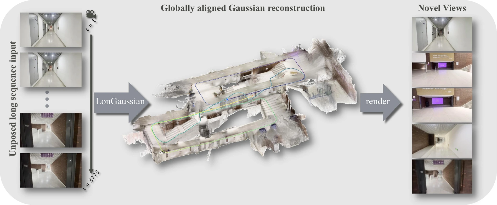
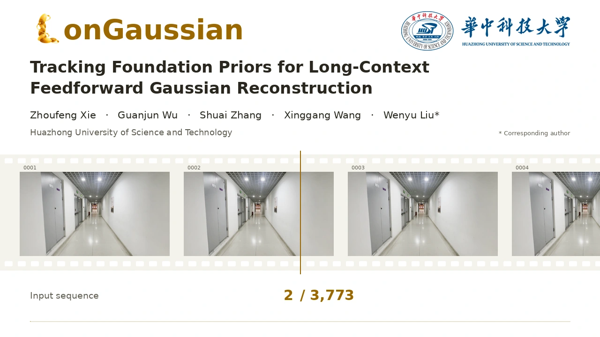
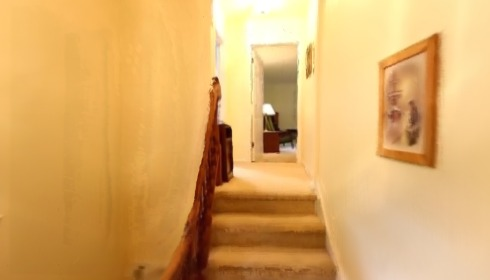
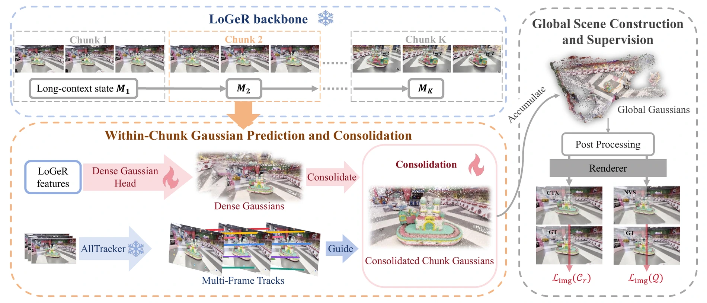

<div align="center">

<h1>LonGaussian</h1>

<p><strong>Tracking Foundation Priors for Long-Context Feedforward Gaussian Reconstruction</strong></p>

<p>
<a href="https://abearkeeper.github.io/LonGaussian.github.io/"></a>
<a href="https://arxiv.org/pdf/2610.23250"></a>
</p>

<p>
<a href="https://github.com/aBearKeeper">Zhoufeng Xie</a><sup>1</sup>,
<a href="https://guanjunwu.github.io/">Guanjun Wu</a><sup>2</sup>,
<a href="https://github.com/Shuaizhang7">Shuai Zhang</a><sup>3</sup>,
<a href="https://xwcv.github.io/">Xinggang Wang</a><sup>3</sup>,
<a href="https://eic.hust.edu.cn/professor/liuwenyu/">Wenyu Liu</a><sup>3</sup> 
</p>

<p>
<sup>1</sup> School of Software Engineering, Huazhong University of Science and Technology<br>
<sup>2</sup> School of Computer Science &amp; Technology, Huazhong University of Science and Technology<br>
<sup>3</sup> School of Electronic Information and Communications, Huazhong University of Science and Technology
</p>

<p> Corresponding author: <a href="mailto:liuwy@hust.edu.cn">liuwy@hust.edu.cn</a></p>

</div>

## Overview

LonGaussian reconstructs compact, renderable Gaussian scenes from long image
sequences. It combines a frozen LoGeR backbone with AllTracker correspondences,
learned Gaussian decoding and merging, dense complement, rendered-depth
filtering, and far-field sky modeling. Input intrinsics are known; camera poses
are estimated by the model.

<p align="center">
  
</p>

The repository provides the full reconstruction pipeline, the paper's two-stage
training recipe, data preparation, inference, and evaluation. Start with
[installation](#installation), [data and weights](#data-and-weights), or
[video demonstrations](#video-demonstrations).

## Video demonstrations

<p align="center">
  <a href="https://abearkeeper.github.io/LonGaussian.github.io/#demo"></a><br>
  <a href="https://abearkeeper.github.io/LonGaussian.github.io/#demo">▶ Watch the overview</a> ·
  <a href="https://abearkeeper.github.io/LonGaussian.github.io/media/videos/long-sequence-teaser-v16-720p.mp4">Download MP4</a>
</p>

Selected novel-view renderings (click an image to play the video):

| DL3DV · 96 context views | RealEstate10K · 64 context views |
| :---: | :---: |
| [](https://abearkeeper.github.io/LonGaussian.github.io/media/videos/b2-ours.mp4) | [](https://abearkeeper.github.io/LonGaussian.github.io/media/videos/a4-ours.mp4) |

For synchronized method comparisons and interactive Gaussian scenes, visit the
[project page](https://abearkeeper.github.io/LonGaussian.github.io/#results).

## Method

LoGeR carries long-context state across chunks and predicts dense Gaussians.
AllTracker supplies within-chunk correspondences to the learned merger; a dense
complement retains regions without reliable tracks. The resulting chunk scenes
are accumulated and filtered before novel-view rendering.

<p align="center">
  
</p>

## Installation

Validated on Linux x86-64 with Python 3.11.13, PyTorch 2.6.0+cu124,
torchvision 0.21.0, CUDA 12.4 and an RTX 3090 (24 GB). A compatible CUDA
toolkit and C++ compiler are needed for gsplat. In a fresh Python 3.11
environment:

```bash
python -m pip install -r requirements-lock.txt
PYTHONDONTWRITEBYTECODE=1 python -m unittest discover -s tests -v
```

The lock includes the CUDA 12.4 PyTorch runtime and data-download dependencies.
`requirements.txt` and `requirements-data.txt` are the unpinned inputs for
resolving a new lock on a different platform.

CUDA is required for training, rendering and evaluation. RE10K video extraction
also needs ffmpeg and Deno.

## Data and weights

Use [DATASETS.md](DATASETS.md) for official-source downloads, deterministic
train/test splits, and evaluation-root preparation. External model identities,
checksums and the checkpoint lineage are in [WEIGHTS.md](WEIGHTS.md). For
example, download the required frozen models to a directory outside this repo:

```bash
python scripts/download_assets.py weights --output /path/to/weights
```

The code repository does not contain datasets or model weights. Full dataset
downloads and training require substantial storage and compute.

## Training

Prepare data with `prepare_training_data.py` and external weights with `download_assets.py weights`. Then:

```bash
python scripts/train_pipeline.py \
  --prepared /path/to/prepared --weights /path/to/weights \
  --output /path/to/run/training --gpus 0,1,2,3
```

The driver validates data counts, metadata hashes and train/test separation before launch.

For two GPUs, replace `--gpus 0,1,2,3` with
`--gpus 0,1 --gradient-accumulation-steps 2`. Each GPU processes one scene at a
time; two microsteps form the same effective batch of four scenes. Learning
rates and optimizer-update counts remain unchanged. Each accumulated update
uses one context bucket; Stage IIb balances sources across the full effective
batch. Failed microsteps abort the run rather than silently changing the batch.
Random streams and floating-point reduction order can differ across GPU counts.

If a sampled image is missing or undecodable, training logs the frame path and
checks the same scene for decodable windows. It resamples a valid start while
preserving context/target offsets, context length and scene identity. Damaged
pixels are never filled and images are never decoded with truncation tolerance.
Scenes without a usable window still fail the synchronized batch validity check;
no partial accumulated update is applied. Resampling is logged and can change the
random stream relative to a run on fully intact data. The preparation option
`--decode-images` provides a stricter, slower preflight that rejects scenes with
any undecodable frames; the default metadata/file-existence check alone does not
guarantee image integrity.

| Stage | Recipe | Final artifact |
| --- | --- | --- |
| I | One pass over 8,590 scenes; dense 16 contexts; two padding draws across 4 GPUs | stage1.pt |
| IIa | Frozen decoder/head; merger only; 900 updates | stage2a.pt |
| IIb | 118 DL3DV + 150 RE10K, 1:1 per global batch; 300 updates; short-context head adaptation | stage2b.pt |

Stages IIa/IIb cycle sparse16 (interval8), dense64, dense96 and dense128 evenly. Stage IIb applies depth/sky postprocessing. The driver refuses incomplete stages or nonfinite checkpoint tensors and writes per-stage reports containing checkpoint hashes, parent hashes, commands and split-manifest hashes.

Use `--dry-run` to inspect commands, `--stage stage2a` to run one stage with the required canonical parent in the same output root, or `--resume-completed` to reuse only verified completed stages. Interrupted stage directories are not silently resumed or overwritten; retain them for diagnosis and use a new run root. The three shell stage launchers call this same driver using `PREPARED_ROOT`, `WEIGHTS_ROOT` and `TRAIN_OUTPUT` environment variables.

Stage II stores model activations on CPU by default to reduce long-context
backward memory peaks. This preserves frames, Gaussians, losses and gradients,
but uses additional host RAM and CPU/GPU transfers. Monitor available host
memory when running multiple workers. On GPUs with sufficient memory, use
`--no-activation-offload` to keep activations on the GPU. View-wise renderer
checkpointing recomputes each view with its own fixed camera indices.

## Full workflow

After preparing two ctx128 evaluation roots, run training, full inference and
both 128-context evaluations. For all main-table lengths, use the settings in
[EVALUATION.md](EVALUATION.md).

```bash
python scripts/run_pipeline.py \
  --prepared /path/to/prepared --weights /path/to/weights --output /path/to/new_run \
  --dl3dv-eval /path/to/eval-dl3dv128 --re10k-eval /path/to/eval-re10k128 \
  --inference-scene /path/to/calibrated_scene --gpus 0,1,2,3
```

`COMPLETE.json` is written only after all stages succeed and all evaluation scene metrics are finite. The inference scene must have at least 24 frames, `transforms.json` with intrinsics and `images_8`. Input camera poses are estimated by the model. Evaluation uses fixed held-out targets and context-only Gaussian construction.

For a small functional test, prepare training with `--smoke`, prepare one evaluation scene per dataset, and add `--profile smoke --gpus 0,1` to the workflow command. Smoke uses reduced resolution, one Stage-I update and four updates in each Stage-II substage, covering all length buckets and balanced two-source DDP. Use `--profile paper` for the full training configuration.

## Inference and evaluation

Use the full LonGaussian entry point for scene reconstruction. It writes a
binary `scene.ply` and `inference.json` after tracking, neural merging, dense
complement, depth filtering and sky-shell construction.

```bash
INPUT=/path/to/calibrated_scene NUM_FRAMES=24 OUTPUT_DIR=/path/to/new_inference \
MODEL_NAME=/path/to/weights/LoGeR_star/latest.pt GAUSSIAN_HEAD=/path/to/run/training/stage2b.pt \
ALLTRACKER_CHECKPOINT=/path/to/weights/alltracker.pth SKY_MASK_ONNX=/path/to/weights/skyseg.onnx \
bash scripts/infer_longaussian.sh
```

For a prepared DL3DV-140 evaluation root:

```bash
DATASET_ROOT=/path/to/eval-dl3dv128 OUTPUT_DIR=/path/to/new_eval NUM_FRAMES=146 \
MODEL_NAME=/path/to/weights/LoGeR_star/latest.pt GAUSSIAN_HEAD=/path/to/run/training/stage2b.pt \
ALLTRACKER_CHECKPOINT=/path/to/weights/alltracker.pth SKY_MASK_ONNX=/path/to/weights/skyseg.onnx \
bash scripts/evaluate_dl3dv140.sh
```

For prepared RE10K use `scripts/evaluate_re10k.sh`. Both wrappers write
`metrics_dl3dv_subset.json`. The six-setting paper protocol and reference
per-view results are described in [EVALUATION.md](EVALUATION.md). The optional
`infer_scene.sh`/`infer.py` entry point is a dense Gaussian-head diagnostic,
not the full method.

Optional `ALLTRACKER_SHA256` verifies a local tracker checkpoint.
`SKY_MASK_ONNX` is required by the formal full pipeline. See
[WEIGHTS.md](WEIGHTS.md) for identities and checksum verification; only load
trusted checkpoint files.

## Repository guide

| Path | Contents |
| --- | --- |
| [`scripts/`](scripts/) | Data preparation, training, inference and evaluation entry points |
| [`loger/`](loger/) | Model, tracking, Gaussian construction and rendering code |
| [`manifests/`](manifests/) | Released fixed evaluation scene lists |
| [`reference/`](reference/README.md) | Checkpoint lineage and per-view reference metrics |
| [`tests/`](tests/) | CPU regression tests |

Keep downloaded datasets, weights and generated outputs outside the source
package. Third-party attribution and applicable terms are in
[THIRD_PARTY_LICENSES.md](THIRD_PARTY_LICENSES.md), [NOTICE](NOTICE) and
[`LICENSES/`](LICENSES/).

## Citation

If you find LonGaussian useful, please cite the arXiv paper:

```bibtex
@misc{xie2026longaussiantrackingfoundationpriors,
      title={LonGaussian: Tracking Foundation Priors for Long-Context Feedforward Gaussian Reconstruction},
      author={Zhoufeng Xie and Guanjun Wu and Shuai Zhang and Xinggang Wang and Wenyu Liu},
      year={2026},
      eprint={2610.23250},
      archivePrefix={arXiv},
      primaryClass={cs.CV},
      url={https://arxiv.org/abs/2610.23250},
}
```
